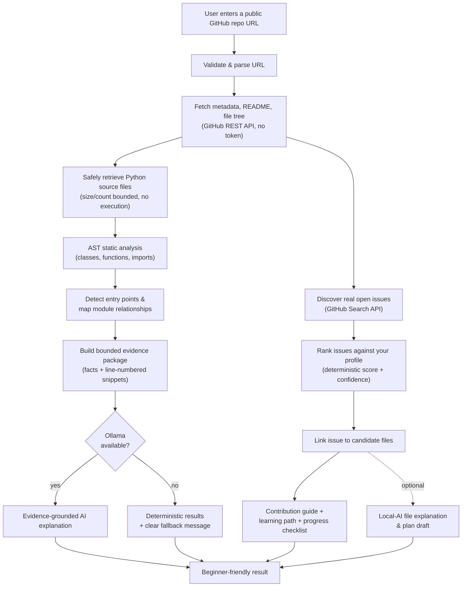

<p align="center">
  
</p>

<h1 align="center">CodePath AI</h1>

<p align="center">
  <strong>Khojo Code. Samjho System. Contribute with Confidence.</strong><br>
  <em>Team CodeYatra</em>
</p>

<p align="center">
  <a href="#deployment"></a>
  <a href="#requirements"></a>
  <a href="#license"></a>
  <a href="#local-ai-with-ollama"></a>
  <a href="#security-model"></a>
</p>

<p align="center">
  <a href="BRAND_GUIDE.md">Brand System Guide</a> ·
  <a href="public/brand/showcase.html">Interactive Showcase</a> ·
  <a href="DEV_NOTES.md">Developer Notes</a>
</p>

---

## Table of Contents

- [The Problem](#the-problem)
- [The Solution](#the-solution)
- [How It Works (Workflow)](#how-it-works-workflow)
- [Architecture Overview](#architecture-overview)
- [Features](#features)
- [Tech Stack](#tech-stack)
- [Requirements](#requirements)
- [Installation & Local Setup (Windows)](#installation--local-setup-windows)
- [Local AI with Ollama](#local-ai-with-ollama)
- [Usage](#usage)
- [Deployment](#deployment)
- [Testing](#testing)
- [Security Model](#security-model)
- [Known Limitations](#known-limitations)
- [Project Structure](#project-structure)
- [License](#license)

---

## The Problem

Open source is the fastest way to grow as a developer, but the first
contribution is the hardest step. A newcomer faces a wall of friction:

- **Where do I start?** Large repositories have hundreds of files and no clear entry point.
- **What does this code even do?** Reading an unfamiliar codebase alone is slow and discouraging.
- **Which issue is right for me?** Issue trackers are noisy; "good first issue" labels are not personalised to a beginner's skills.
- **How do I actually make the change?** The path from "I picked an issue" to "I opened a pull request" is undocumented.

Existing tools assume prior experience, send your code to a remote cloud AI, or
require an API key and a credit card. Beginners are left out.

## The Solution

**CodePath AI** is a beginner-first assistant that turns an unfamiliar public
GitHub repository into a guided contribution journey — **without executing any
downloaded code, without GitHub authentication, and without sending your data to
a cloud LLM.**

You paste a public repository URL and CodePath AI:

1. Reads the repository's **real** metadata, README, file tree, and Python source.
2. Explains the codebase with **evidence grounded in the actual source** (file paths and line numbers).
3. Finds **real open issues** and ranks them against *your* skills with a transparent, deterministic score.
4. Links each issue to the files it likely concerns, and builds a **contribution guide, learning path, and progress checklist**.

The optional AI layer runs **entirely on your machine** through
[Ollama](https://ollama.com), so code never leaves your laptop. When the local
model is unavailable, every non-AI feature still works and the app says so
clearly.

> **Guiding principle:** *facts first, AI second.* Static analysis and scoring
> are deterministic and reproducible. The model only ever *explains* real
> evidence and can never change a score or invent a file that does not exist.

---

## How It Works (Workflow)



---

## Architecture Overview

CodePath AI is a **layered Streamlit application**. A thin UI layer talks to two
independent engines — a deterministic **analyzer** (the source of truth) and an
optional **local-AI** layer (the explainer). The AI layer can be removed and the
application still functions.

```mermaid
flowchart LR
    subgraph UI["Presentation — app.py (Streamlit)"]
        SB["Sidebar controls"]
        T1["Repository explorer"]
        T2["Find your first contribution"]
        T3["Contribution guide"]
    end

    subgraph ANALYZER["Analyzer — deterministic, no execution"]
        GC["github_client\n(safe REST retrieval)"]
        FS["file_scanner\n(AST facts)"]
        CM["code_map\n(entry points, imports, graph)"]
        IC["issue_client\n(read-only issues)"]
        RC["recommender\n(transparent scoring)"]
        IL["issue_linker\n(issue → files)"]
        CG["contribution_guide"]
        LP["learning_path"]
        CK["checklist"]
        CA["cache\n(revision-scoped + TTL)"]
    end

    subgraph AI["Local AI — optional, evidence-bound"]
        MC["model_client\n(Ollama)"]
        CB["context_builder\n(bounded evidence)"]
        IE["issue_explainer"]
        CO["contribution_assistant"]
        SO["structured_output\n(defensive JSON)"]
        PR["prompts\n(untrusted-data safe)"]
    end

    GH["GitHub REST API"]
    OL["Local Ollama"]

    UI --> ANALYZER
    ANALYZER <--> GH
    ANALYZER --> AI
    AI <--> OL
    CA -.-> FS
```



**Design rules baked into the architecture**

- **Facts vs. interpretation.** The analyzer produces static *facts*; the AI
  produces *interpretation*. They are never mixed into one unqualified number.
- **Revision-scoped caching.** Cache keys include the repository identity **and**
  the commit SHA, so results never leak across repositories or revisions.
- **Graceful degradation.** Every AI call has a deterministic fallback; a missing
  model degrades a feature, never the whole app.
- **Least privilege.** Retrieval is read-only, bounded, and never executes code.

---

## Features

### Phase 1 — Repository explorer
- Validate and parse public GitHub URLs (owner/repo identifiers supported).
- Fetch repository metadata, default branch, and commit SHA.
- Fetch the README (decoded safely) and the recursive file tree (with truncation awareness).

### Phase 2 — Codebase intelligence
- **Safe source retrieval** via the GitHub API on the real default branch/revision;
  per-file size limit, max file count, binary/oversized/excluded files skipped and reported.
  No cloning, no code execution.
- **Static analysis** (`analyzer/file_scanner.py`): module names, functions, methods,
  parameters, line ranges, decorators, docstrings, absolute/relative imports via `ast`.
  Syntax errors handled gracefully.
- **Entry-point detection** (`analyzer/code_map.py`): `__main__` guards as **evidence**,
  filename/framework conventions as **heuristics**, each with an explanation.
- **Module relationship mapping** with resolution status (`exact` / `partial` / `unresolved`).
- **Evidence-grounded AI** (`ai/context_builder.py`, `ai/prompts.py`): a compact,
  character-bounded evidence package drives a local model explanation.
- **Analysis caching** (`analyzer/cache.py`), keyed by repository **and** revision.

### Phase 3 — Find your first contribution
- **Read-only issue discovery** (`analyzer/issue_client.py`) via the GitHub Search API
  (PRs excluded, bounded fields, TTL cache). No writes, ever.
- **Deterministic recommender** (`analyzer/recommender.py`): six weighted components —
  skill overlap, label fit, difficulty fit, scope, interest match, and recency.
  Reproducible ranking (score desc, then issue number).
- **Score ≠ confidence:** `match_score` (0–100) measures fit; `confidence` (0–1)
  measures how much evidence exists.
- **Optional local-AI explanation** that never changes the deterministic score and
  filters invented file paths against the real repository.

### Phase 4 — Contribution guide & learning path
- **Issue-to-code linking** (`analyzer/issue_linker.py`): a file is **confirmed** only
  when the issue explicitly names a real path/module/class/function (whole-token match),
  otherwise **likely** on keyword overlap — each with its exact reason.
- **Issue-specific contribution guide** (`analyzer/contribution_guide.py`): problem,
  objective, ordered investigation sequence, questions, and risks. Acceptance criteria
  are *never invented* — only quoted verbatim when the author wrote them.
- **Personalized learning path** (`analyzer/learning_path.py`): fundamentals → skill →
  relevant file → testing → frameworks → Git/GitHub workflow, marked **reinforce** vs
  **to learn**. A missing skill is never treated as proof you lack it.
- **Interactive checklist** (`analyzer/checklist.py`): deterministic, issue-scoped steps
  across *understand → setup → implement → verify → share*.

---

## Tech Stack

| Layer | Technology |
|-------|-----------|
| UI | Streamlit |
| Language | Python 3.10+ (`ast` for static analysis) |
| Repository / issue data | GitHub REST API (unauthenticated) |
| Local AI | Ollama with an open-weight model (e.g. `qwen2.5:3b`) |
| HTTP | `requests` (timeouts + bounded retries) |
| Tests | `pytest` + Streamlit `AppTest` (mocked, offline) |

---

## Requirements

- **Python 3.10+** (developed on Python 3.15; deployed on 3.11).
- **Windows, macOS, or Linux.**
- Internet access to reach `api.github.com` (read-only retrieval).
- **[Ollama](https://ollama.com) — optional**, needed only for AI explanations.
- No GitHub account, token, or `.env` file is required.

---

## Installation & Local Setup (Windows)

From **Command Prompt** (`cmd.exe`):

```bat
git clone https://github.com/TheMukeshDev/CodePath-AI.git
cd CodePath-AI
python -m venv .venv
.venv\Scripts\activate.bat
pip install -r requirements.txt
```

Run the app:

```bat
streamlit run app.py
```

Then open the URL Streamlit prints (usually `http://localhost:8501`).

> **macOS / Linux:** use `python3 -m venv .venv && source .venv/bin/activate`,
> then `streamlit run app.py`.

---

## Local AI with Ollama

AI explanations are **optional** and run entirely offline.

```bat
ollama pull qwen2.5:3b
ollama serve
```

The app auto-detects the model at `http://localhost:11434`. You can change the URL
and model in the sidebar, or via environment variables:

| Variable | Default | Purpose |
|----------|---------|---------|
| `OLLAMA_BASE_URL` | `http://localhost:11434` | Ollama endpoint |
| `OLLAMA_MODEL` | `qwen2.5:3b` | Model name |

**If Ollama is unavailable:** metadata, README, file tree, static analysis, issue
discovery, ranking, guides, learning paths, and checklists all still work. The app
displays a clear message explaining how to enable local AI.

---

## Usage

1. Enter a public repository URL, e.g. `https://github.com/psf/requests`, in the sidebar.
2. **Fetch repository** — loads metadata, README, and the file tree.
3. **Analyze Python codebase** — static analysis, entry points, and dependency mapping.
4. **Generate AI explanation** *(optional, needs Ollama)* — evidence-cited architecture summary.
5. Open **Find Your First Contribution** — enter your skills, discover and rank real issues.
6. Open **Contribution Guide** — pick an issue for a guide, learning path, and checklist.

Nothing is ever written upstream: no commits, comments, or pull requests.

### Example: `psf/requests`

`requests` is a library, so it may legitimately have **no** confirmed application
entry point. CodePath AI reports this fact rather than inventing one. For the test
repository [`noob-mukesh/mukeshrobot`](https://github.com/noob-mukesh/mukeshrobot),
the app reports a genuine **empty issue state** when no open issues exist.

---

## Deployment

The app is ready for **Streamlit Community Cloud** (free, unlimited public apps).
Deployment config lives at the repository root:

| File | Purpose |
|------|---------|
| `.streamlit/config.toml` | Server configuration (required at repo root) |
| `requirements.txt` | Python dependencies (Streamlit pinned) |
| `Dockerfile` / `Procfile` / `render.yaml` | Alternative hosts / local containers |

### Deploy on Streamlit Community Cloud

1. Push the repository to GitHub.
2. Go to **https://share.streamlit.io** and sign in with GitHub.
3. **Create app** → *Deploy a public app from GitHub*.
4. Set:
   - **Repository:** `TheMukeshDev/CodePath-AI`
   - **Branch:** `main`
   - **Main file path:** `app.py`
5. **Advanced settings** → choose **Python 3.11** → leave **Secrets empty**.
6. **Deploy**. You get a public URL such as `https://codepath-ai.streamlit.app`.

> **Cloud note:** Ollama runs only on your machine. On a hosted deployment the AI
> tabs show the built-in fallback message, while every other feature works normally.
> Unauthenticated GitHub API requests are limited to **60 requests/hour per IP**;
> on shared cloud IPs you may occasionally see a rate-limit notice.

### Alternative: Render / Docker

```bat
docker build -t codepath-ai .
docker run -p 8501:8501 codepath-ai
```

`render.yaml` and `Procfile` are provided for one-click Render deployment.

---

## Testing

```bat
.venv\Scripts\python.exe -m pytest tests -v
```

The suite is deterministic and requires **no network connection and no model**:
GitHub and Ollama responses are mocked. It covers URL validation, GitHub response
handling, README/file-tree retrieval, Python source analysis, invalid and
inaccessible repositories, empty issue results, issue ranking with fixtures,
contribution-guide generation, Ollama-unavailable fallback, and a live Streamlit
`AppTest` UI smoke test of session-state behaviour.

Latest local run:

```
204 passed, 8 skipped
```

---

## Security Model

- **No execution:** analyzed code is never imported, evaluated, or run — only `ast.parse`.
- **No writes upstream:** the app never commits, pushes, comments, or opens pull requests.
- **Untrusted input:** repository files, READMEs, metadata, and issue text are treated
  as data (not instructions) and embedded in explicit untrusted blocks. Prompt injection
  is ignored by design.
- **Bounded retrieval:** per-file size limit, max file count, directory exclusions,
  binary detection, timeouts, and bounded retries.
- **Path safety:** repository URLs and paths are validated; `..` traversal is rejected.
- **No secrets required:** the app works with no GitHub token and no `.env`. If a token
  is optionally supplied, it is only placed in request headers and never logged.
- **Rate limits:** GitHub `403/429` responses raise a clear, actionable error instead of
  failing silently — an API failure is never treated as a successful empty result.
- **Score integrity:** the deterministic recommendation score is pure Python and is never
  produced or altered by a model.
- **Symbol validation:** when the model explains a file, backticked symbols are checked
  against the file's real symbols; invented names are dropped and reported.

---

## Known Limitations

- **Python only** (`*.py`, `*.pyi`). Other languages are ignored; the analyzer is layered
  so they can be added later.
- **Static analysis is incomplete.** Dynamic imports (`importlib`, `__import__`), runtime
  configuration, plugin registries, and framework magic cannot be fully detected.
- **Unauthenticated GitHub limits** apply (60 requests/hour/IP).
- **Local AI requires Ollama** and a modest machine; a ≈3B model is recommended for
  8 GB RAM. Cloud deployments have no AI features.
- The app **does not modify repositories**; the final contribution is always made by you.

---

## Project Structure

```
CodePath-AI/
├── app.py                         # Streamlit UI (all phases)
├── analyzer/                      # Deterministic engine (no execution)
│   ├── github_client.py           # Safe GitHub REST retrieval
│   ├── file_scanner.py            # AST extraction (facts only)
│   ├── code_map.py                # Entry points, import resolution, graph
│   ├── issue_client.py            # Read-only issue discovery
│   ├── recommender.py             # Transparent skill/difficulty matching
│   ├── issue_linker.py            # Issue → candidate files
│   ├── contribution_guide.py      # Issue-specific guide
│   ├── learning_path.py           # Personalized learning path
│   ├── checklist.py               # Per-issue contribution checklist
│   └── cache.py                   # Revision-scoped cache + TTL cache
├── ai/                            # Optional local AI (evidence-bound)
│   ├── model_client.py            # Local Ollama client (graceful failures)
│   ├── context_builder.py         # Bounded evidence package
│   ├── issue_explainer.py         # Optional JSON issue explanations
│   ├── contribution_assistant.py  # Optional file explain / plan draft
│   ├── structured_output.py       # Defensive JSON parsing
│   └── prompts.py                 # Untrusted-data-safe prompts
├── public/                        # Brand assets (logo, favicons, showcase)
├── tests/                         # pytest suite (offline, mocked)
├── .streamlit/config.toml         # Streamlit server configuration
├── requirements.txt
├── Dockerfile / Procfile / render.yaml
└── README.md
```

---

## License

Released under the **MIT License** — see [LICENSE](LICENSE).

Original application code © 2026 **Team CodeYatra**. Third-party dependencies and
brand assets remain subject to their own licenses.

<p align="center"><em>Khojo Code. Samjho System. Contribute with Confidence.</em></p>
